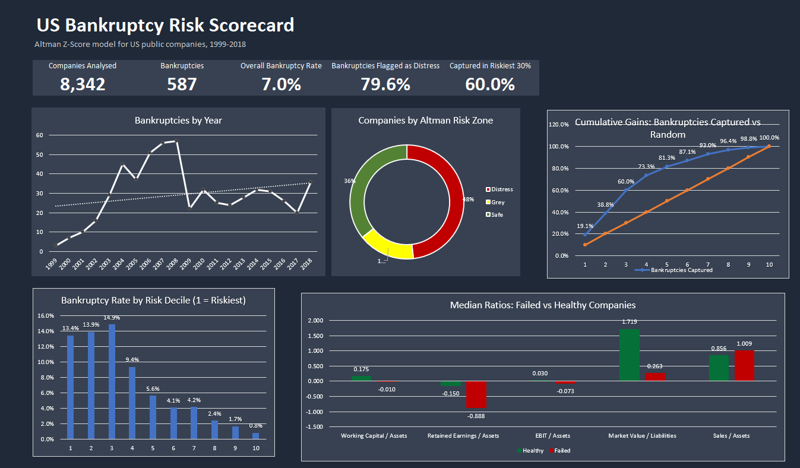
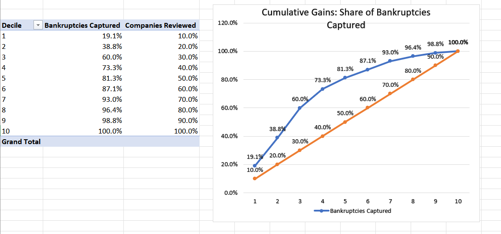
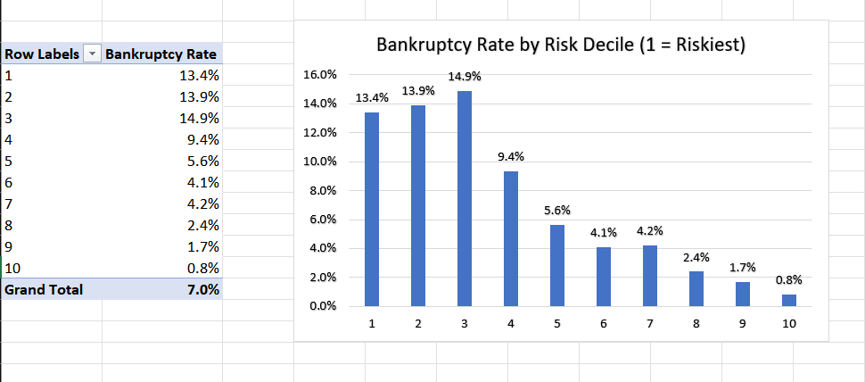
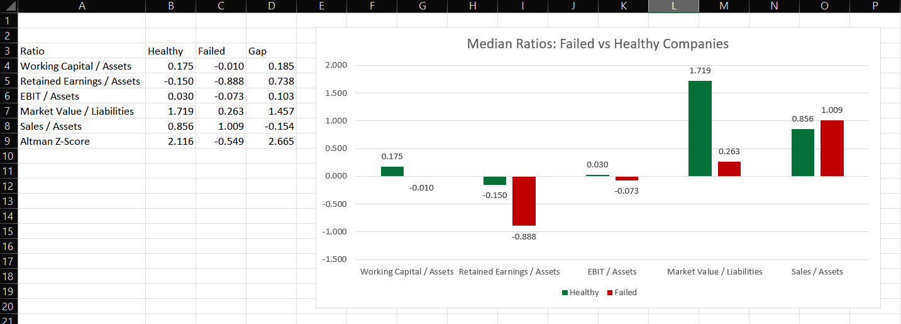
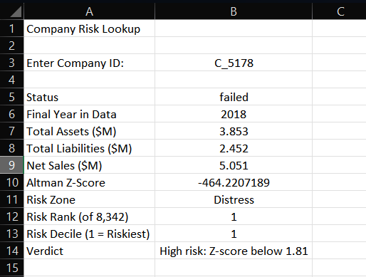

#  US Bankruptcy Risk Scorecard — Excel + Power Query


> An early-warning **risk scorecard for US public companies** built in Excel with the **Altman Z-score**.
> Power Query cleans and scores the data, pivot tables and pivot charts power a dark-theme dashboard, and a lookup sheet scores any company on demand.



## 📌 Headline results

| Metric | Value |
|---|---:|
| Companies scored | **8,342** (of 8,971; 629 excluded for assets or liabilities < 1) |
| Bankruptcies | **587** (7.0 %) |
| Bankruptcy rate by zone | **Distress 11.6 %** · Grey 4.4 % · Safe 2.0 % |
| Bankruptcies inside the Distress zone | **79.6 %** |
| Bankruptcies captured in the riskiest 30 % of companies | **60.0 %** |
| Healthy companies also in the Distress zone | ~46 % *(many false positives)* |

## 📸 Screenshots

| Cumulative gains (pivot + chart) | Bankruptcy rate by risk decile |
|---|---|
|  |  |



<details>
<summary>Company Lookup</summary>



</details>

> Optional: `src/make_charts.py` re-creates the headline charts as PNGs in `images/generated/` straight from the CSV.

## 🗂️ Workbook tour (`excel/US_Bankruptcy_Risk_Scorecard.xlsx`)

| Sheet | Purpose |
|---|---|
| `Dashboard` | 5 KPI tiles + pivot charts (trend, zone mix, deciles, cumulative gains, median ratios) |
| `Clean Data` | Power Query output: 78,682 firm-years + failed flag, last-year flag, ratios, Altman Z, zone |
| `Company Scores` | One row per scored company (final year), ranked and split into risk deciles |
| `Methodology` | Purpose, data, cleaning, exclusions, model, results, limitations, how to use |
| `Zone Validation` · `Decile Lift` · `Risk by Decile` · `Cumulative Gains` | Pivot tables validating the score |
| `Bankruptcy Trend` · `Zone Mix` · `Ratio Comparison` | Supporting pivots / median-ratio table |
| `Company Lookup` | Type a company ID → status, Z-score, zone, rank, decile, verdict |

##  Method in brief

1. **Power Query** renames `X1…X18`, adds `Failed_Flag`, finds each company's last year, and flags rows valid for scoring (`Total_Assets ≥ 1` and `Total_Liabilities ≥ 1`).
2. **Altman Z** = 1.2·WC/TA + 1.4·RE/TA + 3.3·EBIT/TA + 0.6·MVE/TL + 1.0·Sales/TA → **Safe** > 2.99, **Grey** 1.81–2.99, **Distress** < 1.81.
3. Because every year of a failed company is labelled *failed*, scoring uses **one row per company (its last year)**; the last year also serves as the bankruptcy-year proxy.
4. Companies are ranked by Z (riskiest first) and cut into 10 deciles for lift / cumulative-gains analysis.

Full details: [`docs/methodology.md`](docs/methodology.md) · M code: [`powerquery/scorecard_queries.m`](powerquery/scorecard_queries.m).

## ✅ Validation

`src/validate_scorecard.py` re-implements the Power Query logic in pandas and compares **73 numbers** (KPIs, zone table, all deciles, yearly trend, median ratios) with the workbook's values — **all match**.

```bash
pip install -r requirements.txt
python src/validate_scorecard.py        # expect: ALL CHECKS PASSED
python src/make_charts.py               # regenerate images/generated/*.png
```

##  Using the workbook

* Open in **Excel 2021 or Microsoft 365** (the lookup uses `XLOOKUP`). The file is ~35 MB.
* **Company Lookup** → enter an ID such as `C_5178` in `B3`.
* **Refreshing data:** *Data → Queries & Connections → american_bankruptcy → Edit*, set the `Source` step to your local `data/raw/american_bankruptcy.csv`, then *Data → Refresh All*.

## ⚠️ Limitations

* The Altman (1968) model was built for public manufacturers; the data has no industry column.
* The Distress zone flags many healthy firms (low precision); results are descriptive, not a forecast.
* The riskiest three deciles fail at similar rates (13–15 %): ranking within the top 30 % is weak — see [`docs/review_notes.md`](docs/review_notes.md).
* There is no failure date, so a failed company's last reported year is used as a proxy.
* Variable meanings follow the standard Compustat mapping and amounts are assumed to be USD millions.

## 📁 Repository structure

```
├── README.md · LICENSE · requirements.txt · .gitignore · .gitattributes
├── data/raw/american_bankruptcy.csv
├── excel/US_Bankruptcy_Risk_Scorecard.xlsx
├── powerquery/scorecard_queries.m
├── src/validate_scorecard.py · make_charts.py
├── docs/methodology.md · data_dictionary.md · review_notes.md
└── images/                 # Excel screenshots (+ generated/ charts)
```

## 👤 Author

**Shubham Adate** — Data Analyst · [LinkedIn](https://www.linkedin.com/in/adate-shubham) · [GitHub](https://github.com/shubhamadatework-git)

## 📄 Data & license

Data: Kaggle "US Company Bankruptcy Prediction Dataset" (CC0), based on Lombardo et al. (2022), *Future Internet* 14(8):244. Code and workbook: [MIT](LICENSE).
